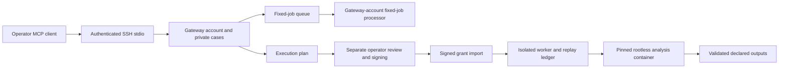

# Architecture and security

[Documentation index](index.md) / [Installation path](installation.md)

The gateway presents analysis through MCP over authenticated SSH stdio. Cases remain on the analysis host. There is no gateway HTTP server or telemetry endpoint in the qualified implementation.

This is a logical trust-boundary diagram, not a network deployment command. The diagram's operator signer is separate from chat and from the analysis host's worker state.

## Three processing roles

The **gateway account** accepts MCP requests, manages its private case store and queues fixed built-in jobs. A separate `jobwork.py` process runs those fixed jobs under the same gateway identity. This processor is started deliberately; its foreground mode is not a boot-persistent service.

The **sandbox worker account** has separate private state, image storage, execution history and replay ledger. It runs the installed signed-execution service. The gateway cannot read the worker's private home or user-manager connection. Root-owned policy and code establish the identities and permitted boundary.

The **operator signer** reviews the exact script, inputs, image and resource bounds, and issues a one-use, expiring signed decision. SSH authentication is separate from execution authorization. The gateway does not hold the signing private key. Synthetic signing used during qualification is not human approval.

## Controls to preserve

Signed execution uses a digest-pinned image with no sandbox network, a read-only root filesystem, dropped capabilities, no-new-privileges and explicit CPU, memory, PID, execution-time and output bounds. Approved inputs are bound by identity; only declared safe output files are accepted. SELinux remains Enforcing and aggregate worker limits remain active.

Grants are checked and consumed through the protected execution path. Do not edit SQLite state, restore an old nonce ledger or bypass the import workflow to make a job run. A changed script or image requires a new reviewed plan and authorization.

## Failure and recovery

Container startup can have asynchronous side effects after a CLI timeout. The qualified runtime preserves an uncertain launch as RUNNING and blocks further execution during the same boot. A reviewed reboot allows subsequent exact-container cleanup and interruption recovery. Removing a marker or resetting history is not recovery.

This deliberately conservative behavior matters when choosing a host: a reboot on a shared host affects other services. Installation, image/trust changes and recovery require an administrator's explicit maintenance decision. Approved public availability will not expand this profile to direct Internet exposure.
